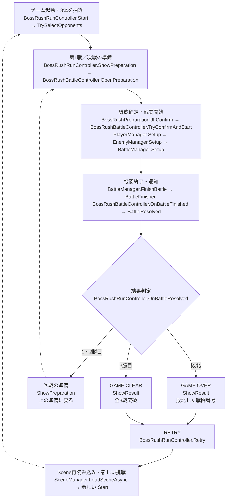

# BREAK TACTICS BossRush
**Phase 3-C｜追加コード解説　/　Unity 2023.2.22f1**

## 1　追加・変更コード一覧

| ファイル名 | 追加したメソッド・変数・イベント等 | 役割 |
| --- | --- | --- |
| BossRushRunController.cs | **新規** `BattleCount`、`Phase`、`opponents`、`phase`、`Victories`、`CurrentBattleNumber` | 抽選結果、勝利数、現在の戦闘番号と進行状態を管理する。 |
| BossRushRunController.cs | **新規** `battleController`、`enemyCandidates`、`encounterPreview`、`resultPanel`、`resultTitle`、`resultMessage`、`retryButton` | 敵候補とScene上の参照をInspectorで接続する。 |
| BossRushRunController.cs | **新規** `OnEnable`、`OnDisable`、`Start`、`TrySelectOpponents`、`ShowPreparation` | 通知を購読・解除し、候補検証と抽選を経て準備画面を開く。 |
| BossRushRunController.cs | **新規** `OnBattleStarted`、`OnBattleResolved`、`ShowConfigurationError`、`ShowResult`、`Retry` | 戦闘への移行、勝敗分岐、設定エラー表示、再挑戦を担当する。 |
| BossRushBattleController.cs | **追加** `BattleStarted`、`BattleResolved`。**変更** `OpenPreparation`、`TryConfirmAndStart`、`OnBattleFinished`。**削除** `enemyData`、`Start` | 1戦の開始・終了を進行側へ通知する。初回準備は進行側から開く。 |
| BossRushPreparationUI.cs | **変更** `RefreshSkillCards` の `interactable` 設定 | 職業選択前は候補へのクリックを受け付けない。 |
| BattleManager.cs | **削除** `Setup` 内の `ResetPlayerBattleState()` 呼び出し | 開始時のプレイヤー状態初期化を1回にする。 |
| EnemyManager.cs | **追加** `initialized`。**変更** `Start`、`InitializeFromData` | `Setup` 済みの敵に能力値を再代入しない。 |
| DialogTextManager.cs | **追加** `Clear` | 会話の表示、進行位置、クリックの記録を消去する。 |

比較元はPhase 3-C開始前の `BreakTactics_BossRush_Backup_Phase3-C-20261116-055945`。既存5ファイルの差分で追加・変更・削除を確認した。`// 追加` には過去フェーズの印もある。行番号は現行ソースを示す。抜粋の範囲外は省略した。

## 2　BossRushRunController.cs
### 定数・enum・フィールド・プロパティ（9-32行）

`BattleCount` は3。`Phase` は `Initializing`、`Preparing`、`Fighting`、`Result`、`Reloading` の5状態を表す列挙型で、`phase` に現在の状態を保持する。

`[SerializeField]` を付けた私有フィールドはInspectorで設定できる。`enemyCandidates` は現在8体の候補配列、`opponents` は抽選後の対戦順。`Victories` はクラス内で更新できるプロパティで、`CurrentBattleNumber` は `Mathf.Min(Victories + 1, BattleCount)` を返す。全勝後も表示は第3戦まで。

### OnEnable → OnDisable → Start（34-83行）

有効化時に戦闘通知とボタンを購読し、無効化時に解除する。Unityが初回有効化後に呼ぶ `Start` は参照を検証し、抽選成功後に `ShowPreparation` を呼ぶ。

<!-- pagebreak -->
## 2　BossRushRunController.cs（続き）


**BossRushRunController.cs / TrySelectOpponents（117-124行、抜粋）**

```csharp
        var available = new List<EnemyData>(candidates);
        selected = new EnemyData[BattleCount];
        for (int i = 0; i < BattleCount; i++)
        {
            int index = Random.Range(0, available.Count);
            selected[i] = available[index];
            available.RemoveAt(index);
        }
```

**何をしているか・重要な構文**　`static` はインスタンスの状態を使わず、引数で抽選する。候補不足、`null`、参照の重複、Prefabルートの `EnemyManager` が有効かを先に確認する。`HashSet<EnemyData>.Add` は登録済みの参照で `false`。失敗は `return false` と `out error`、成功は `true` と `out selected` で返す。
**なぜ必要か・ほかのクラスとの関係**　`Start` から受け取った候補配列を可変長の `List<EnemyData>` にコピーする。`Random.Range` の整数版は上限を含まない。抽選するたび `RemoveAt` で候補を除くため、同じ敵を再抽選せず、3要素の配列がそのまま対戦順になる。

### ShowPreparation → OnBattleStarted（130-147行）

`opponents[Victories]` で次の敵を取り出す。たとえば1勝後は添字1、つまり2体目。`encounterPreview` に第何戦かと敵名を表示し、状態を `Preparing` にして `OpenPreparation` に渡す。開始通知を受けた `OnBattleStarted` は、準備中なら `Fighting` に進める。


**BossRushRunController.cs / OnBattleResolved（156-169行、抜粋）**

```csharp
        if (result == BattleResult.Defeat)
        {
            ShowResult("GAME OVER", $"第{CurrentBattleNumber}戦で敗北しました。");
            return;
        }

        Victories++;
        if (Victories == BattleCount)
        {
            ShowResult("GAME CLEAR", $"{BattleCount}戦すべてを突破しました。");
            return;
        }

        ShowPreparation();
```

**何をしているか・重要な構文**　冒頭のガードで `Fighting` のときだけ処理する。敗北は勝利数を増やさず、結果を出して `return`。勝利は `++` で1加算し、3勝目も結果表示で `return` する。第1・第2戦の勝利だけが最後の `ShowPreparation` に到達する。
**なぜ必要か・ほかのクラスとの関係**　`BattleResolved` を受け、同じ通知で次戦を二重に開いたり、第4戦に進んだりするのを防ぐ。`ShowConfigurationError` はエラーを記録し、`ShowResult` は状態を `Result` にして見出しと本文を表示する。


**BossRushRunController.cs / Retry（200-202行、抜粋）**

```csharp
        phase = Phase.Reloading;
        retryButton.interactable = false;
        SceneManager.LoadSceneAsync(sceneIndex, LoadSceneMode.Single);
```

**何をしているか・重要な構文**　結果画面中かつビルド登録済みのとき、先に `Reloading` に切り替え、ボタンを無効にして `LoadSceneAsync` を呼ぶ。
**なぜ必要か・ほかのクラスとの関係**　連打で再読み込みを重ねず、`LoadSceneMode.Single` で現在のSceneを置き換える。新しい進行・戦闘コントローラーが作られ、`Start` の再抽選と初期状態の編成で再開する。

<!-- pagebreak -->
## 3　BossRushBattleController.cs
**1戦の境界を3連戦の進行に伝える**

### 初回準備の呼び出し元

Phase 3-Bの `enemyData` フィールドと `Start` は削除された。現在は `BossRushRunController.Start` が抽選後に準備を開始する。従来の1戦開始処理は `TryConfirmAndStart` に残る。


**BossRushBattleController.cs / BattleStarted・BattleResolved（38-40行、抜粋）**

```csharp
    // 追加
    public event Action BattleStarted;
    public event Action<BattleResult> BattleResolved;
```

**何をしているか・重要な構文**　`event` は外部から購読・購読解除できる通知。`Action` は引数なし、`Action<BattleResult>` は勝敗を1つ受け取る戻り値なしの処理を表す。`+=` で受け手を登録し、`-=` で外す。
**なぜ必要か・ほかのクラスとの関係**　進行側は `OnEnable` / `OnDisable` でこの2つを購読・解除する。戦闘側が既存の `BattleManager.BattleFinished` を購読・解除する処理は実装前から存在した。


**BossRushBattleController.cs / OpenPreparation（74-78行、抜粋）**

```csharp
        // 追加
        if (DialogTextManager.instance != null)
        {
            DialogTextManager.instance.Clear();
        }
```

**何をしているか・重要な構文**　対戦相手を `pendingEnemy` に置き、`DialogTextManager.instance` が存在すれば `Clear()` を呼んでから準備画面を表示する。`instance` は既存の `static` フィールドで、クラス名を通して参照できる。
**なぜ必要か・ほかのクラスとの関係**　`BossRushRunController.ShowPreparation` が初戦と中間準備でこのメソッドを使う。前の勝敗メッセージやクリックの記録を消してから編成へ移る。


**BossRushBattleController.cs / TryConfirmAndStart（141-143行、抜粋）**

```csharp
        // 追加
        BattleStarted?.Invoke();
        return true;
```

**何をしているか・重要な構文**　編成確定後、`PlayerManager.Setup`、敵の生成・初期化、`BattleManager.Setup` を順に呼び、今回追加の開始通知を出す。`?.Invoke()` は購読者がいる場合だけ呼び出す。
**なぜ必要か・ほかのクラスとの関係**　待機している進行側に開始を伝え、結果を受け付ける `Fighting` に移行させる。編成の検証・確定はPhase 3-Bの `BossRushRunState.TryBeginBattle` が担当する。


**BossRushBattleController.cs / OnBattleFinished（148-152行、抜粋）**

```csharp
        // 追加
        if (!run.IsInBattle)
        {
            return;
        }
```

**何をしているか・重要な構文**　`!run.IsInBattle` は戦闘中フラグが偽であることを表す。該当する場合は `return` で処理を止める。既存の `run.FinishBattle()` でフラグを下ろし、BGM停止と結果ログの後に、今回追加の `BattleResolved?.Invoke(result)` を出す。
**なぜ必要か・ほかのクラスとの関係**　ロック解除後、進行側の `OnBattleResolved` へ伝えるので、勝利直後に次戦の準備を開ける。戦闘側のガードと進行側の `Phase.Fighting` 判定で重複を防ぐ。

<!-- pagebreak -->
## 4　既存4クラスの変更


**BossRushPreparationUI.cs / RefreshSkillCards（193-194行、抜粋）**

```csharp
            // 追加
            card.button.interactable = draftPlayer != null;
```

**何をしているか・重要な構文**　`draftPlayer != null` の真偽を `Button.interactable` に代入する。仮選択中の職業がない間、表示中の候補を押せなくする。
**なぜ必要か・ほかのクラスとの関係**　RETRY直後のクリックが候補へ入るのを防ぐ。既存の `Show` は前回の職業を `draftPlayer` へ復元し、`SkillUseRules.IsCommonSkill` で装備を固有・自由に分ける。戦闘間は復元直後から候補を操作できる。

### BattleManager.cs / Setup（削除）

`Setup` の `ResetPlayerBattleState()` 呼び出しを1箇所削除した。毒・戦闘限定効果は `BossRushBattleController.TryConfirmAndStart` が直前に呼ぶ既存の `PlayerManager.Setup` でリセット済み。ここで再実行すると、開始処理のどこが状態初期化を受け持つかが曖昧になる。HP・MPの全快とCD初期化も `PlayerManager.Setup` が担当し、`BattleManager` はUI・入力・ターン進行を担当する。戦闘終了時と無効化時のリセット呼び出しは残る。


**EnemyManager.cs / Start（334-338行、抜粋）**

```csharp
        // 追加
        if (initialized)
        {
            return;
        }
```

**何をしているか・重要な構文**　追加した `bool initialized` は初期値が `false`。生成直後に `BossRushBattleController` が `Setup` を呼ぶと、既存の `InitializeFromData` が能力値を入れ、末尾で `initialized = true`（364行）にする。Unityがその後 `Start` を呼んでも、`return` で終わる。
**なぜ必要か・ほかのクラスとの関係**　`Start` が再初期化するとHPやMPを最大値へ再代入するため、開始直後の変化を上書きし得る。事前の `Setup` がない個体では、既存どおり `Start` がデータを確認して初期化する。


**DialogTextManager.cs / Clear（132-146行、抜粋）**

```csharp
    // 追加
    public void Clear()
    {
        displayVersion++;
        scenarios = Array.Empty<string>();
        currentLine = 0;
        currentText = string.Empty;
        timeUntilDisplay = 0;
        timeElapsed = Time.time;
        lastUpdateCharacter = -1;
        lastAdvanceFrame = -1;
        lastAdvanceReleaseFrame = -1;
        isAdvancePointerHeld = false;
        uiText.text = string.Empty;
    }
```

**何をしているか・重要な構文**　`Array.Empty<string>()` で会話の配列を空にし、表示中の文字・行・時刻とクリックの記録をリセットする。`displayVersion++` は表示の世代を進めるため、古い世代の `ShowAndWait` は既存の照合で終了する。
**なぜ必要か・ほかのクラスとの関係**　`Awake` の既存処理が `DontDestroyOnLoad` で会話オブジェクトを保持する。戦闘間もRETRY後も `OpenPreparation` から `Clear` を呼び、前のメッセージや入力待ちを引きずらないようにする。

<!-- pagebreak -->
## 5　全体の処理フロー



### 戦闘が終わってから、次の準備へ

既存の `BattleManager.FinishBattle` は、入力・選択・予告を解除し、VFXと敵を片付ける。敵の破棄の反映を `yield return null` で1フレーム待った後、`BattleFinished` を発行する。職業・装備・職業変更回数は既存の `BossRushRunState` に保持される。

### Phase 3-Cで追加された機能

既存8体から重複なく選ばれた3体と順に戦えるようになった。戦闘間では次の敵を確認し、前回の職業・4スキルを引き継いで再編成できる。各戦はHP・MP全快で始まり、3勝でGAME CLEAR、途中敗北でGAME OVERになる。どちらの結果からもRETRYで敵の抽選と編成を最初からやり直せる。
